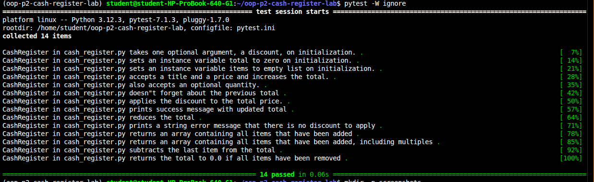

# Cash Register

A `CashRegister` class that simulates the checkout of an e-commerce site. It tracks the items added, the running total, an optional percentage discount, and a history of transactions so the last one can be voided.

## Features

- **Discount validation:** the discount must be a whole number from 0 to 100. Anything else prints `Not valid discount`.
- **Add items:** `add_item(item, price, quantity=1)` adds to the total and the items list, and records the transaction.
- **Apply a discount:** `apply_discount()` takes the discount percentage off the total. With no discount, it prints `There is no discount to apply.`
- **Void a transaction:** `void_last_transaction()` removes the most recent `add_item` from the total, the items list and the transaction history.

## Attributes

| Attribute | Description |
|---|---|
| `discount` | Percentage off the total (0 to 100). Defaults to 0. |
| `total` | Running total of everything added. Starts at 0. |
| `items` | List of items added, with one entry per unit. |
| `previous_transactions` | List of dictionaries with the `item`, `price` and `quantity` of each `add_item` call. |

## Setup

```
pipenv install
pipenv shell
```

## Usage

```python
from lib.cash_register import CashRegister

register = CashRegister(20)          # 20% discount

register.add_item("macbook air", 1000)
register.add_item("mouse", 25, 2)    # quantity of 2
print(register.total)                # 1050

register.void_last_transaction()     # removes the two mice
print(register.total)                # 1000
print(register.items)                # ['macbook air']

register.apply_discount()
# After the discount, the total comes to $800.

CashRegister(150)                    # prints: Not valid discount
```

## Running the tests

```
pytest
```

All 14 tests should pass.

## Screenshot



## Project structure

```
lib/
  cash_register.py    # CashRegister class
  testing/
    cash_register_test.py
screenshots/
  tests.png           # passing test run
```